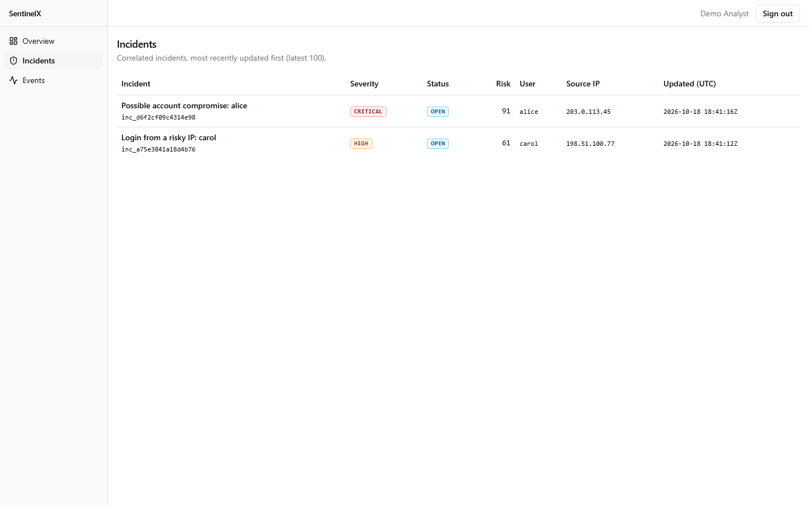
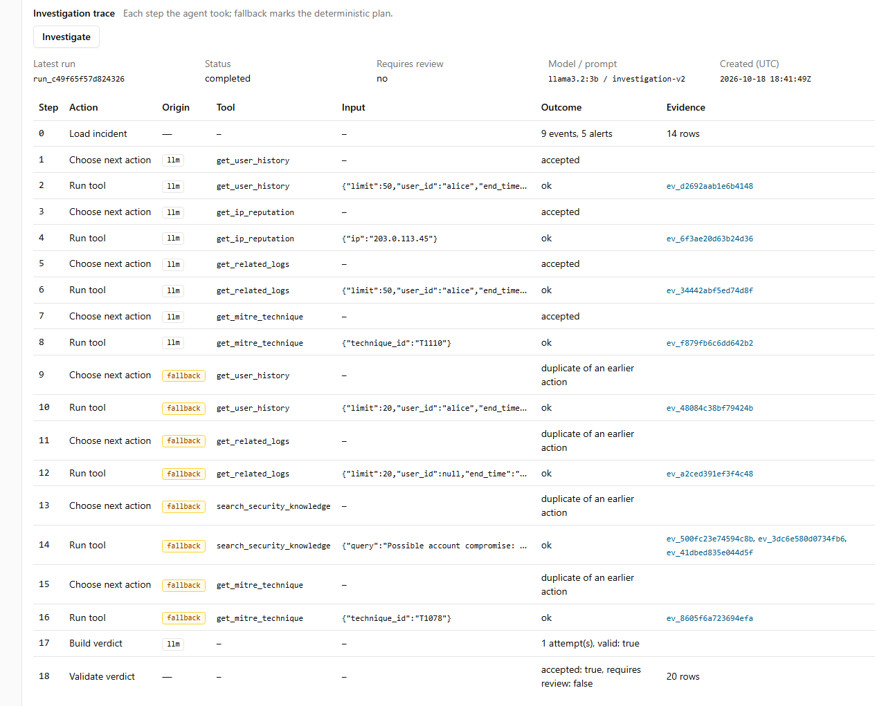
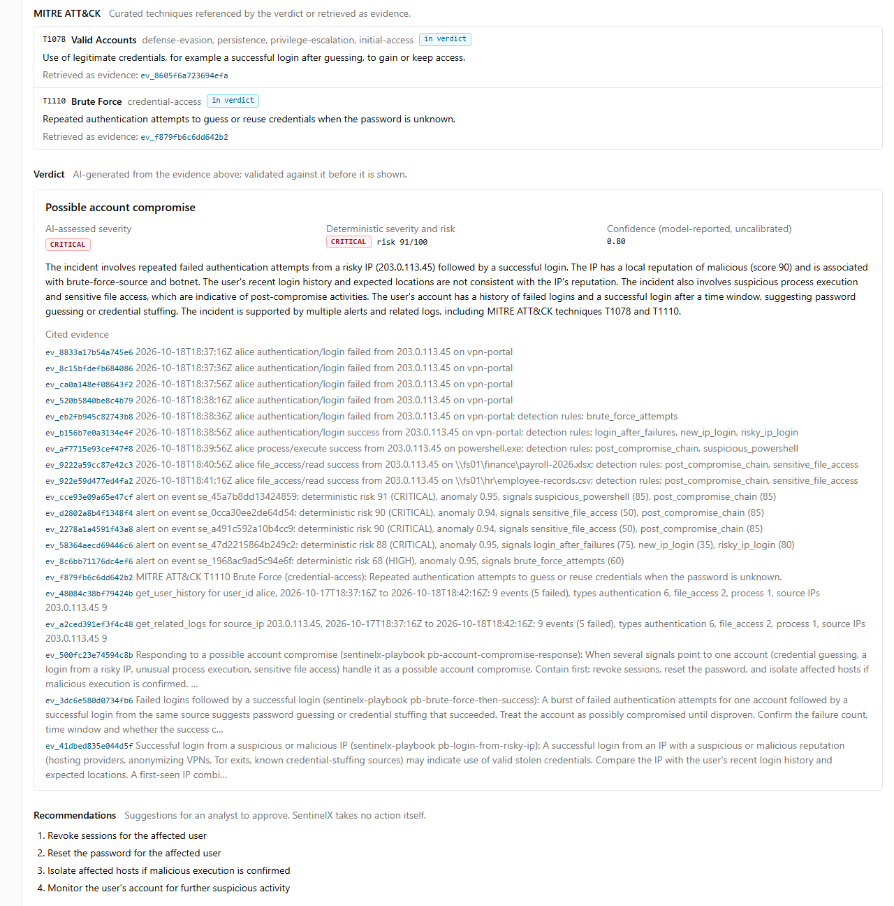

# SentinelX

AI-assisted security-log analysis and evidence-based threat investigation. A portfolio/research-grade prototype, not an enterprise SIEM.

Deterministic code detects, scores and correlates. A small local LLM only investigates: it gathers evidence through read-only tools, and code rejects any verdict that cites something it did not retrieve.

```
Browser → Next.js → Kafka → Detection worker (rules, Isolation Forest, risk, correlation) → PostgreSQL incidents
                                                                                              ↓
Next.js incident UI ← validated verdict + trace ← LangGraph + read-only tools ← FastAPI AI service ← Qdrant, Ollama
```

## Screenshots
Captured from the running Docker stack on synthetic demo data (scenario A, one investigation by `llama3.2:3b`).

| | |
|---|---|
|  |  |
| Correlated incidents with deterministic risk | Every agent step, marked `llm` or `fallback` |



The full incident page (timeline, signals, trace, evidence, verdict) is in [docs/assets/incident-detail.png](docs/assets/incident-detail.png).

## Key properties
- **The LLM never owns the risk score.** A documented formula over rule, anomaly, IP-reputation and correlation inputs produces the 0–100 score; the model's severity is shown separately and labelled AI-assessed.
- **Evidence-grounded verdicts.** Every cited evidence ID and MITRE technique must exist in the run; otherwise the verdict is rejected, flagged for review, and kept for audit.
- **Read-only agent.** Five typed tools, a SELECT-only database role, bounded windows and results. No shell, arbitrary SQL or remediation tools exist.
- **Local-first.** PostgreSQL, Kafka, Qdrant and Ollama run on your machine; nothing is sent to a cloud service.
- **Auditable.** Append-only investigation trace and evidence; no hidden chain-of-thought is stored.

## Tech stack
| Layer | Technology |
|---|---|
| Web console and API | Next.js 16 (App Router), React 19, TypeScript 6 (strict), Tailwind CSS 4, shadcn-style components (Radix UI, class-variance-authority), zod for boundary validation |
| Database | PostgreSQL 17, Drizzle ORM and migrations, least-privilege roles per service |
| Messaging | Apache Kafka 4.1 (single-node KRaft) |
| Detection | Python 3.12, scikit-learn (Isolation Forest), numpy, confluent-kafka, psycopg |
| AI service | FastAPI, Pydantic 2, LangGraph, LangChain core (typed tools), Qdrant 1.15, sentence-transformers (`all-MiniLM-L6-v2`), Ollama (`llama3.2:3b`) |
| Infrastructure | Docker Compose, non-root multi-stage images |
| Testing | Vitest, Pytest, Playwright, ruff, mypy, ESLint; `scripts/verify.py` runs them all |

## Documentation
| | |
|---|---|
| [Setup and demo](docs/setup-and-demo.md) | Run the full stack in Docker and walk an attack scenario end to end |
| [Architecture](docs/architecture.md) | Components, trust boundaries, data model, agent graph, tools, UI |
| [Design decisions](docs/design-decisions.md) | Why each component, tradeoffs, measured performance, limitations |
| [Security](docs/security.md) | Security rules, prompt policy, checklist with test evidence and accepted risks |
| [Development](docs/development.md) | Environment, running from source, coding standards, test plan |
| [API contracts](docs/api-contracts.md) | Browser-facing API and internal AI service; schemas in [`contracts/v1/`](contracts/v1/README.md) |
| [Decision log](docs/decisions.md) | Numbered architecture decisions (D-nnn) cited from code and docs |

## Run the demo
Docker plus Ollama on the host (`ollama pull llama3.2:3b`), nothing else. Full steps, the demo story and an automated check: [docs/setup-and-demo.md](docs/setup-and-demo.md).

```sh
cp .env.example .env                 # then set AI_SERVICE_TOKEN, QDRANT_API_KEY, INGEST_API_TOKEN (32+ random chars each)
docker compose --profile app up -d --build                      # http://localhost:3000
docker compose --profile app run --rm -e ANALYST_PASSWORD='<12+ chars>' setup npm run --silent analyst:create -- analyst@sentinelx.local "Demo Analyst"
docker compose --profile app run --rm setup npm run --silent demo:send -- A --url http://web:3000
```
Sign in, open the new incident, press **Investigate**.

## Develop
Apps on the host, infrastructure in Compose. Prerequisites and Windows/POSIX details: [docs/development.md](docs/development.md).

```sh
cp .env.example .env                 # PowerShell: Copy-Item .env.example .env
# set AI_SERVICE_TOKEN and QDRANT_API_KEY in .env: python -c "import secrets; print(secrets.token_urlsafe(32))"
docker compose up -d
(cd apps/web && npm ci && npm run db:migrate && npm run db:seed && npm run db:roles)
# per service: create services/<name>/.venv with Python 3.12, then pip install -r requirements-dev.txt
python scripts/verify.py             # lint, types, unit, integration and E2E checks
```

## Repository layout
- `apps/web/` — Next.js console and JSON API; Drizzle schema, migrations and seeds.
- `services/detection/` — Python detection worker: rules, Isolation Forest, risk engine, correlation.
- `services/ai/` — Python FastAPI AI service: LangGraph investigation, read-only tools, Qdrant retrieval, Ollama adapter, verdict validation.
- `contracts/v1/` — versioned cross-service JSON Schemas.
- `fixtures/` — deterministic synthetic data (demo scenarios, IP reputation, MITRE subset, playbooks).
- `scripts/` — `verify.py`, the single verification entrypoint.
- `docs/` — documentation (above).
- `docker-compose.yml` — PostgreSQL, Kafka (KRaft), Qdrant; with `--profile app` also the web console, detection worker and AI service.
