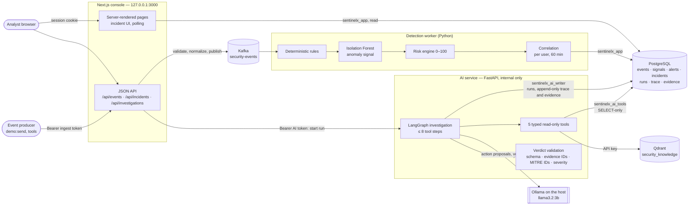
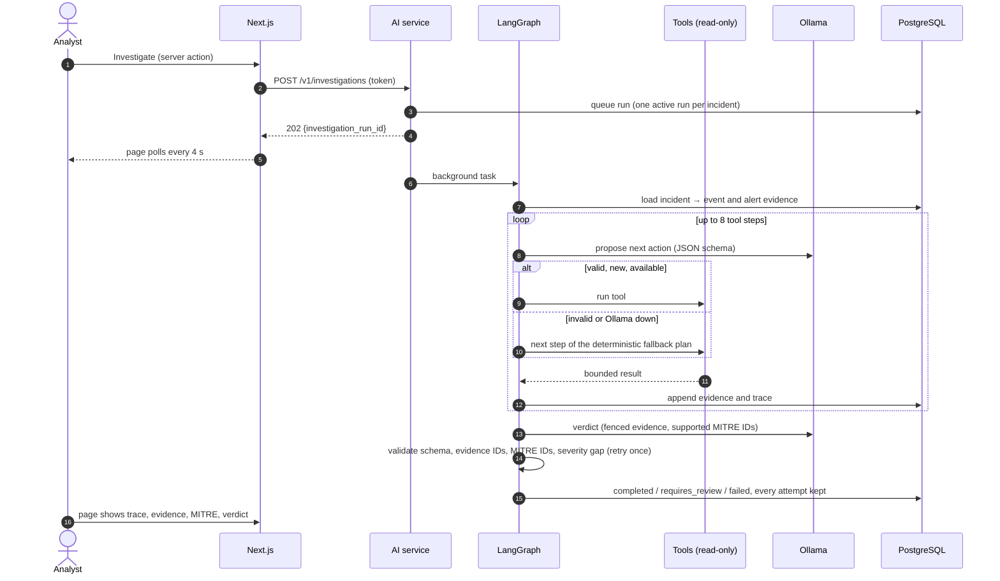

# Architecture

The system as built. The reasons behind each component, with the alternatives rejected, are in [design-decisions.md](design-decisions.md); every decision is logged in [decisions.md](decisions.md).

## System

Trust boundaries:
- Only the console is published, on 127.0.0.1. The AI service accepts only the Next.js server's token, and in Compose it is not published at all.
- Each service connects to PostgreSQL as its own least-privilege role. The agent's tools can only read.
- The LLM sees code-written evidence claims and produces a verdict, which code validates before anyone sees it. The model never sets the risk score.

## Investigation sequence

## Deployment topologies
| | Development | Clean-machine demo |
|---|---|---|
| Command | `docker compose up -d` | `docker compose --profile app up -d --build` |
| In containers | PostgreSQL, Kafka, Qdrant | the same, plus `setup` and `knowledge` (one-shot), `web`, `detection`, `ai` |
| On the host | Next.js, the detection worker, the AI service, Ollama | Ollama only |
| Gate | `python scripts/verify.py` (24 checks) | `apps/web/demo-check` (docs/setup-and-demo.md) |

## Boundaries
- **Web** owns the UI, the session boundary and the user-facing APIs.
- **Detection** owns rules, features, the anomaly model, risk and correlation.
- **AI** owns LangGraph, the tools, retrieval, the LLM adapter, verdict validation and trace creation.
- **PostgreSQL** owns persistence. Drizzle migrations are the only DDL (D-010).

Cross-service payloads are versioned JSON Schemas in `contracts/v1/` (D-011, D-042, D-059).

Do not add a service without a concrete boundary and a documented reason.

## Scope
SentinelX ingests security events, detects suspicious activity using deterministic rules and anomaly detection, correlates signals into incidents, and investigates incidents using an evidence-grounded read-only LangGraph agent.

### Functional requirements
- Event ingestion: normalized JSON/CSV/demo events with event_id, timestamp, user_id, source_ip, event_type, action, resource, status, metadata.
- Detection: repeated failed logins, unusual successful login, suspicious PowerShell, sensitive file access, privilege escalation, impossible travel where sufficient data exists, suspicious event chains.
- Anomaly detection: Isolation Forest over documented features; output is an anomaly signal, not final risk.
- Risk engine: deterministic 0–100 score from rule score, anomaly score, event severity, IP reputation and correlation/context. Levels LOW 0–29, MEDIUM 30–59, HIGH 60–79, CRITICAL 80–100.
- Correlation: bounded user/IP/category/time-window correlation.
- Investigation: LangGraph workflow with typed read-only tools.
- Tools: get_user_history, get_ip_reputation, get_related_logs, get_mitre_technique, search_security_knowledge.
- RAG: Qdrant retrieval of approved security knowledge/MITRE data.
- Verdict: verdict, confidence, severity, summary, evidence_ids, MITRE techniques, recommendations.
- Trace: action/tool, input summary, result summary, evidence IDs, retrieval refs, timestamps. Never persist hidden chain-of-thought.
- Dashboard: overview, incidents, incident detail, timeline, signals, evidence, MITRE and investigation trace.

### Non-functional
Local-first, Docker Compose, reproducible tests, graceful failures, bounded tools, schema validation, no secrets in git, usable on a laptop.

### Out of scope
Enterprise SIEM integrations, autonomous remediation, production-scale Kafka operations, Kubernetes, cloud deployment, real blocking/quarantine, fine-tuning, multi-agent swarm.

## End-to-end workflow
### Detection
1. Submit event.
2. Validate and normalize.
3. Publish to Kafka.
4. Detection worker consumes and persists the event idempotently on `external_event_id` (D-014).
5. Evaluate deterministic rules.
6. Extract ML features.
7. Run Isolation Forest.
8. Calculate deterministic risk.
9. Persist signals.
10. Correlate alerts.
11. Create/update incident.
12. Expose incident to UI.

### Investigation
1. Analyst opens incident.
2. Starts investigation; API returns `202` with `investigation_run_id` and the UI polls for status (D-015).
3. LangGraph loads incident.
4. Evaluates evidence.
5. Chooses bounded tool action.
6. Tool executes.
7. Result becomes evidence.
8. Graph decides whether more evidence is needed.
9. Retrieve security knowledge/MITRE through tools; results are stored as evidence (D-018).
10. Ollama produces structured verdict.
11. Validate schema and evidence references.
12. Invalid/unsupported result becomes `requires_review=true`.
13. Persist trace and verdict.
14. UI renders evidence and recommendations.

### Demo chain
5 failed logins -> successful login -> new/high-risk IP -> PowerShell -> sensitive file access -> high anomaly -> risk ~90 -> incident -> evidence gathering -> MITRE retrieval -> evidence-backed Possible Account Compromise verdict.

## Data model
Use PostgreSQL + Drizzle. Drizzle migrations are the only source of DDL (D-010). Source of truth: `apps/web/src/db/schema.ts` and `apps/web/drizzle/`.

IDs are database-generated prefixed text (D-030), e.g. `inc_3f9a2b1c4d5e6f70`. Timestamps are `timestamptz` (UTC). Enums: `severity` (`LOW|MEDIUM|HIGH|CRITICAL`), `incident_status` (`open|investigating|resolved`), `investigation_run_status`, `action_origin`, `evidence_source_type`, `reputation_level`.

Core tables:
- `analysts` (`an_`): id, email (unique, lowercase), name, password_hash (scrypt, D-034), created_at. Console login accounts only (D-012).
- `analyst_sessions` (`ses_`): id, analyst_id, token_hash (SHA-256 of the cookie token, unique), created_at, expires_at, revoked_at (D-034).
- `security_events` (`se_`): id, external_event_id (unique), occurred_at, user_id, source_ip (inet), event_type, action, resource, status, metadata_json, created_at. `user_id` is a monitored external identity with no foreign key to `analysts`. The API field `timestamp` maps to `occurred_at`.
- `detection_signals` (`sig_`): id, event_id, rule_name (required), rule_score (0–100), severity, reason, created_at; unique (event_id, rule_name). Rule hits only (D-021).
- `alerts` (`alt_`): id, event_id (unique), risk_score (0–100), anomaly_score, model_version, severity, reasons_json, created_at.
- `incidents` (`inc_`): id, title, status (default `open`), risk_score (0–100), severity, primary_user_id, primary_ip (inet), started_at, updated_at, created_at
- `incident_events`: incident_id, event_id (composite PK)
- `incident_alerts`: incident_id, alert_id (composite PK)
- `investigation_runs` (`run_`): id, incident_id, status (default `queued`), requires_review (default false), verdict_json (accepted verdict only), raw_output_json (`{attempts: [{valid, output | raw, error?, findings}]}`), validation_errors_json (`[{attempt, code, detail, effect}]`), model_name, prompt_version, error_message, started_at, completed_at, created_at (D-015, D-019, D-073)
- `investigation_trace` (`trc_`): id, investigation_run_id, step_index (≥0, unique per run), action_type, action_origin (`llm|fallback`, null for system nodes), tool_name, input_json, result_json, evidence_ids_json, retrieval_refs_json, created_at
- `evidence` (`ev_`): id, investigation_run_id, source_type, source_id, claim, data_json, created_at (D-018)
- `knowledge_documents` (`kd_`): id, source, external_id, title, content_hash, qdrant_point_id, metadata_json, created_at; unique (source, external_id)
- `ip_reputation`: ip (inet PK), reputation, score (0 benign – 100 malicious), tags_json, source, updated_at. Synthetic local data (D-020).
- `mitre_techniques`: technique_id (PK, `T####` or `T####.###`), name, tactics_json, description, attack_version. Curated local subset (D-020).

Foreign keys connect every child to its parent; no cascading deletes (audit data is preserved). Indexes: `security_events` (occurred_at), (user_id, occurred_at), (source_ip, occurred_at); `incidents` (status, updated_at); `detection_signals`/`alerts` via their unique keys; link tables on the second column; `investigation_runs` (incident_id); `evidence` (investigation_run_id); `knowledge_documents` (content_hash). JSON only for genuinely flexible metadata.

### Database roles (D-022, D-031)
`npm run db:roles` enables LOGIN for `sentinelx_app`, `sentinelx_ai_tools` (D-061) and `sentinelx_ai_writer` (D-065). No role has DELETE, TRUNCATE or CREATE.

| Role | SELECT | INSERT/UPDATE |
|---|---|---|
| owner (`POSTGRES_USER`) | all; runs migrations and seeds | all |
| `sentinelx_app` (web + detection; LOGIN via `npm run db:roles`, D-035) | all tables | analysts, analyst_sessions, security_events, detection_signals, alerts, incidents, incident_events, incident_alerts |
| `sentinelx_ai_tools` (agent tools; LOGIN via `npm run db:roles`, D-061) | security_events, detection_signals, alerts, incidents, incident links, knowledge_documents, ip_reputation, mitre_techniques | none |
| `sentinelx_ai_writer` (investigation runs, trace, evidence; LOGIN via `npm run db:roles`, D-065) | pipeline tables + investigation_runs, investigation_trace, evidence | INSERT/UPDATE investigation_runs; INSERT only investigation_trace, evidence |

Reference data (`ip_reputation`, `mitre_techniques`, `knowledge_documents`) is written by the owner through seed/ingestion scripts.

## Investigation agent
### Graph
`START -> load_incident -> analyze_evidence -> choose_next_action -> execute_tool -> store_evidence -> analyze_evidence -> build_verdict -> validate_verdict -> END`

`analyze_evidence` routes either to `choose_next_action` (more evidence needed and budget left) or to `build_verdict` (sufficient evidence, no useful action left, or step budget reached).

State includes investigation_run_id, incident_id, incident, evidence[], available_tools[], actions_taken[], retrieval_refs[], verdict, requires_review, errors[], step_count.

Default maximum investigation steps: 8. Tool calls and result sizes are bounded.

### Action selection (D-017)
The LLM proposes one action from `available_tools` as structured output. The proposal is validated against the tool input schema and the step budget. An invalid proposal, or an unavailable Ollama, falls back to a deterministic plan for the incident type. Every action is traced with `action_origin` (`llm` or `fallback`).

Knowledge and MITRE retrieval happen through `search_security_knowledge` and `get_mitre_technique` inside the loop. Every tool result, including retrieved knowledge, is stored as an evidence row (D-018).

The agent chooses evidence-gathering actions. It does NOT calculate the authoritative numeric risk score. Verdict `severity` is an AI assessment: a difference of two or more levels from the deterministic incident severity sets `requires_review=true`. `confidence` is model-reported and uncalibrated (D-016).

### Failure behavior
- tool timeout: trace failure and continue if possible;
- invalid tool args: reject action, use fallback;
- invalid LLM JSON: retry once, then mark review;
- unsupported evidence ID or unknown MITRE ID: reject verdict, keep raw output (D-019);
- dependency unavailable: preserve incident and investigation failure state.

Do not request or persist hidden chain-of-thought. Persist only auditable trace metadata.

### Implementation
`services/ai/sentinelx_ai/graph.py` (graph, prompts, fallback plan, `Investigator`), `store.py` (writer-role persistence), `evidence.py` (code-written claims). Decisions: D-064 (flow, trace rows), D-065 (writer role, run lifecycle), D-066 (evidence and fallback plan), D-067 (knowledge search only with a retriever), D-068 (verdict attempts and review). Knowledge retrieval lives in `knowledge.py` (D-070–D-072); `grounding.py` provides the grounded `build_verdict`/`validate_verdict` (D-073).

## Agent tools
All tools are read-only and typed. Database-backed tools use the SELECT-only role (D-022) through fixed parameterized queries.

### get_user_history
Input: user_id, start_time, end_time, limit. Bounded time window and result count.

### get_ip_reputation
Input: ip. Return attributes from the local `ip_reputation` table (D-020); unknown IPs return `unknown`. No external calls.

### get_related_logs
Input: optional user_id/source_ip, time range, optional event_types, limit. Bounded results.

### get_mitre_technique
Input: technique_id. Return the row from the local `mitre_techniques` table (D-020); unknown IDs return a typed not-found result.

### search_security_knowledge
Input: query, top_k (bounded). Retrieve from Qdrant through a retriever interface (fake in tests, Qdrant in production; D-026). Results carry `knowledge_documents` source IDs.

Forbidden tool capabilities: raw SQL, filesystem access, shell execution, arbitrary HTTP, arbitrary Python, mutation actions.

Every tool requires input/output schemas, timeout, maximum result size, read-only declaration and tests.

Implementation: `services/ai/sentinelx_ai/tools.py`. `build_tools(ToolDatabase(AI_TOOLS_DATABASE_URL), retriever)` returns exactly these five LangChain `StructuredTool`s with `metadata.read_only = true` (D-060). The tools connect only as `sentinelx_ai_tools` in read-only, 2-second statement-timeout sessions (D-061). Bounds: window ≤ 7 days, limit ≤ 50, `top_k` ≤ 10, results ≤ 32 KiB (D-062). The retriever contract is in D-063. Without a retriever, `build_tools(db, None)` omits knowledge search (D-067). `QdrantRetriever` over the `security_knowledge` collection; hits carry `document_id` (`kd_`), `source` and `external_id`, and are checked against `knowledge_documents` (D-070–D-072).

## UI
Desktop-first internal console with compact sidebar and content area.

Pages: `/`, `/incidents`, `/incidents/[id]`, `/events`, optional `/settings`.

Incident page order: identity/status -> risk/severity -> summary -> timeline -> detection signals -> evidence -> MITRE -> investigation trace -> verdict -> recommendations.

Visual language: restrained, professional, information-dense, accessible. Monospace for IPs, IDs and timestamps.

Every data view must handle loading, empty, error, success and degraded states. Demo data must be clearly labeled.

Implementation (D-074): `apps/web/src/app/(console)/incidents/[id]/page.tsx` renders the order above, using the sections in `src/components/incident/sections.tsx` and the pure helpers in `src/lib/investigation-view.ts`. The investigation trace sits before evidence so the reader sees how the evidence was gathered. The verdict separates AI-assessed severity and uncalibrated confidence from the deterministic risk; a review banner explains every validation finding; recommendations are labelled as suggestions for analyst approval. The page polls while a run is queued or running. `e2e/walkthrough.spec.ts` walks scenario A through every section.
